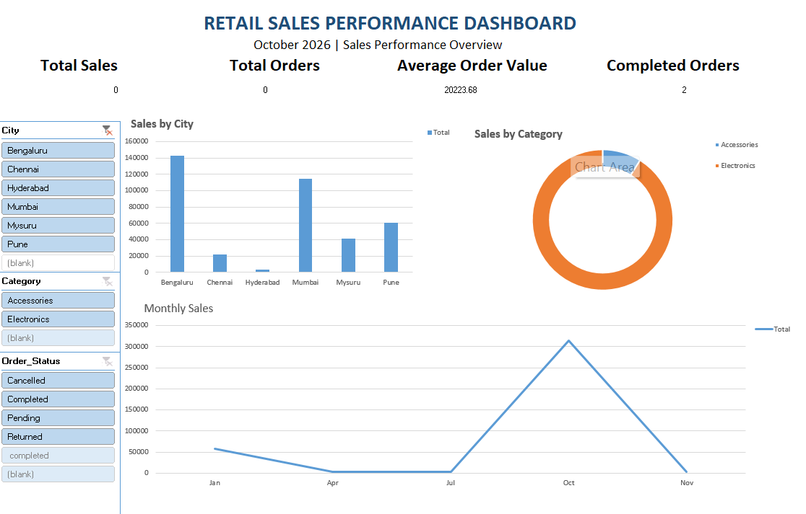

# 📊 Retail Sales Performance Dashboard

## 📌 Project Overview

The **Retail Sales Performance Dashboard** is a data analytics project designed to analyze and visualize retail sales performance.

This dashboard provides meaningful insights into sales trends, order performance, city-wise sales, and product category distribution. It helps users understand business performance through interactive charts, KPIs, and filters.

## 🎯 Project Objectives

- Analyze overall retail sales performance.
- Track total orders and completed orders.
- Identify top-performing cities based on sales.
- Understand sales distribution across product categories.
- Analyze monthly sales trends.
- Provide interactive filters for better data exploration.

## 📈 Dashboard Features

### 1. Key Performance Indicators (KPIs)
- Total Sales
- Total Orders
- Average Order Value
- Completed Orders

### 2. Sales by City
A bar chart representing sales performance across different cities:
- Bengaluru
- Chennai
- Hyderabad
- Mumbai
- Mysuru
- Pune

### 3. Sales by Category
A donut chart showing the distribution of sales across product categories:
- Accessories
- Electronics

### 4. Monthly Sales Analysis
A line chart displaying monthly sales trends to identify changes in sales performance over time.

### 5. Interactive Filters
The dashboard includes filters to analyze data based on:
- City
- Category
- Order Status (Cancelled, Completed, Pending, Returned)

## 🛠️ Tools & Technologies

- Microsoft Excel
- Pivot Tables
- Pivot Charts
- Slicers
- Data Visualization

## 📊 Key Insights

This dashboard helps identify:

- Sales performance across different cities.
- Revenue contribution from different product categories.
- Monthly sales fluctuations.
- Order status distribution.
- Overall retail business performance.

## 📷 Dashboard Preview

## 🚀 Conclusion

This project demonstrates the use of data analysis and visualization techniques to transform retail sales data into meaningful business insights.

It helps improve understanding of sales trends, customer orders, and business performance through an interactive dashboard.

---

**Project Type:** Data Analytics

**Created by:** Usha P
